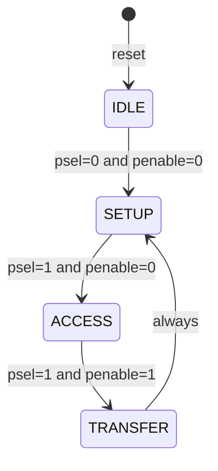
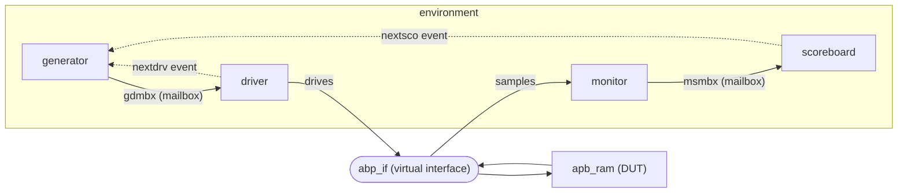
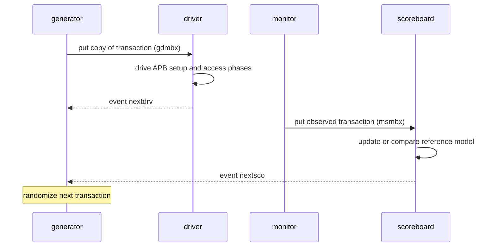

# APB RAM: Class-Based SystemVerilog Verification Environment

A from-scratch, **class-based, constrained-random testbench** (generator, driver, monitor, scoreboard, environment) that verifies a small **AMBA APB slave RAM** (32 words x 32 bits). The testbench supports reads, writes, random read/write traffic and **slave-error injection** (out-of-range addresses), and checks every read against a reference model.

> [!IMPORTANT]
> **Authorship and AI disclosure**
>
> - **The DUT (`apb_ram` and the `abp_if` interface) was generated with an AI assistant.** It exists in this repository only as a verification target.
> - **The testbench (`transaction`, `generator`, `driver`, `monitor`, `scoreboard`, `environment`, `tb`) was written by me.** The verification work is the point of this project.
> - The documentation in this README was drafted with AI assistance. The simulation log and waveform analyzed here come from my own simulation runs.

---

## Table of contents

1. [Quick results](#1-quick-results)
2. [APB in 60 seconds](#2-apb-in-60-seconds)
3. [The DUT: `apb_ram`](#3-the-dut-apb_ram)
4. [Testbench architecture](#4-testbench-architecture)
5. [Running the simulation](#5-running-the-simulation)
6. [Understanding the output](#6-understanding-the-output)
7. [Waveform walkthrough](#7-waveform-walkthrough)
8. [Scope of the testbench](#8-scope-of-the-testbench)
9. [Future enhancements](#9-future-enhancements)
10. [Repository layout](#10-repository-layout)
11. [Skills demonstrated](#11-skills-demonstrated)

---

## 1. Quick results

One run with `gen.count = 30` transactions:

| Metric | Result |
|---|---|
| Transactions generated | 30 |
| Writes stored in reference model | 11 |
| Reads checked against model | 12 |
| Reads that matched (`Data Matched`) | **12** |
| Mismatches (`Data Mismatched`) | **0** |
| Slave errors injected and flagged (`SLV ERROR DETECTED`) | **7** |

Operation mix in this run (the generator uses `randc`, so each operation type appears once per cycle of four):

| Operation | Count | What it did |
|---|---|---|
| `write` | 8 | Directed writes |
| `read` | 8 | Directed reads |
| `random` | 7 | 3 turned into writes, 4 into reads (random `pwrite`) |
| `error` | 7 | 2 write errors, 5 read errors (address 32 to 100) |

The exact distribution of reads and writes changes with the simulator and seed. The total (30) and the 4-way `randc` balance do not.

---

## 2. APB in 60 seconds

AMBA APB is a simple, low-power peripheral bus. A transfer has two phases:

| Phase | `PSEL` | `PENABLE` | Meaning |
|---|---|---|---|
| **Setup** | 1 | 0 | Requester presents address, direction and write data (one cycle) |
| **Access** | 1 | 1 | Transfer completes when the completer drives `PREADY` high |

| Signal | Direction (from requester) | Purpose |
|---|---|---|
| `PCLK`, `PRESETn` | in | Clock and active-low reset |
| `PSEL`, `PENABLE` | out | Select and enable (phase control) |
| `PWRITE` | out | 1 = write, 0 = read |
| `PADDR`, `PWDATA` | out | Address and write data |
| `PRDATA` | in | Read data |
| `PREADY` | in | Completer is ready; lets the slave insert wait states |
| `PSLVERR` | in | Completer reports a failed transfer |

---

## 3. The DUT: `apb_ram`

*(AI-generated; see the disclosure above.)*

A 32-entry, 32-bit-wide memory with an APB slave interface and a four-state FSM.

### Ports

| Port | Dir | Width | Description |
|---|---|---|---|
| `presetn` | in | 1 | Active-low, **synchronous** reset (sampled on `pclk`) |
| `pclk` | in | 1 | Clock |
| `psel` | in | 1 | Slave select |
| `penable` | in | 1 | Access-phase enable |
| `pwrite` | in | 1 | 1 = write, 0 = read |
| `paddr` | in | 32 | Word address (valid range 0 to 31) |
| `pwdata` | in | 32 | Write data |
| `prdata` | out | 32 | Read data |
| `pready` | out | 1 | Transfer ready |
| `pslverr` | out | 1 | Slave error |

### Behavior

| Case | Memory | `pready` | `pslverr` | `prdata` |
|---|---|---|---|---|
| Write, `paddr < 32` | `mem[paddr] <= pwdata` | 1 | 0 | unchanged |
| Read, `paddr < 32` | unchanged | 1 | 0 | `mem[paddr]` |
| Write, `paddr >= 32` | **not written** | 1 (one cycle later than a normal transfer) | **1** | unchanged |
| Read, `paddr >= 32` | unchanged | 1 (one cycle later) | **1** | `32'hxxxxxxxx` |
| Reset | all words cleared to 0 | 0 | 0 | 0 |

### FSM



State encodings (enum): `idle = 0`, `setup = 1`, `access = 2`, `transfer = 3`. These are the values you see on the `state` signal in the waveform.

How it works:

- **SETUP** waits for `psel=1, penable=0`. If `paddr < 32` it sets `pready` so the response is available as soon as the access phase starts.
- **ACCESS** sees `psel && penable`, then writes or reads memory (or flags an error) and moves on.
- **TRANSFER** clears `pready` and `pslverr` and returns to SETUP.

### Notes for verification engineers

- The DUT is an APB3-style subset: **no `PSTRB` or `PPROT`**, and addresses are word-indexed (no byte offsets).
- **`prdata` is sticky.** It is only cleared in reset or the IDLE state, so it holds the last read value across subsequent writes. The waveform shows this.
- A normal transfer is **zero wait state**. An out-of-range transfer has **one wait state** (`pready` and `pslverr` arrive one cycle later).
- The interface is named `abp_if` in the source files, and this README uses that name throughout.

---

## 4. Testbench architecture

### Block diagram



### One transaction, end to end



The generator waits for **both** events before producing the next transaction, so exactly one transaction is in flight at a time (lock-step).

### Components

| Class | Role | Key details |
|---|---|---|
| **`transaction`** | Stimulus and observation record | `randc op_type oper` (`write`, `read`, `random`, `error`); `rand` `paddr`, `pwdata`, `psel`, `penable`, `pwrite`; observed `prdata`, `pready`, `pslverr`. Includes `display(tag)` and a deep `copy()` |
| **`generator`** | Randomizes and dispatches | Randomizes one reused `tr`, sends `tr.copy` to the driver, then waits on `nextdrv` and `nextsco`. Raises `done` after `count` transactions |
| **`driver`** | Turns transactions into APB signal activity | `reset()` task, then a `run()` loop that implements the four operation types over the virtual interface |
| **`monitor`** | Passive observer | Detects setup then access phases on the bus, captures address, direction, data and `pslverr`, and forwards to the scoreboard |
| **`scoreboard`** | Reference model and checker | Local array model, updates on good writes, compares on good reads, reports slave errors |
| **`environment`** | Wires everything together | Creates mailboxes and events, shares the virtual interface, runs `pre_test` (reset), `test` (all components in parallel) and `post_test` (wait for `done`, then `$finish`) |
| **`tb` (top)** | Simulation top | Instantiates `abp_if` and `apb_ram`, generates a 20-time-unit clock, creates the environment with `count = 30`, dumps `dump.vcd` |

### Stimulus: the four operation types

| `oper` | What the driver does | Address | `pwrite` |
|---|---|---|---|
| `write` | Normal APB write | Constrained 2 to 4 | Forced to 1 |
| `read` | Normal APB read | Constrained 2 to 4 | Forced to 0 |
| `random` | Normal transfer, direction from the randomized `pwrite` | Constrained 2 to 4 | Random |
| `error` | Out-of-range access to provoke `PSLVERR` | **Overridden** with `$urandom_range(32, 100)` | Random |

Constraints in `transaction`:

```systemverilog
constraint addr_c { paddr  > 1; paddr  < 5;  }   // addresses 2, 3, 4
constraint data_c { pwdata > 1; pwdata < 10; }   // data 2 to 9
```

Data never equals 0, so a stored value cannot be confused with the reset value of 0.

### Design decisions worth knowing

- **`randc` on the operation type** cycles through all four operations before repeating, which guarantees balanced coverage of write, read, random and error (30 transactions gives 8/8/7/7). It only works because the generator **reuses one `transaction` object**, which keeps the `randc` history.
- **`copy()` before `mbx.put`** avoids aliasing, so the driver's copy does not change when the generator randomizes the next transaction.
- **Mailboxes carry data, events carry synchronization.** The two mailboxes (`gdmbx`, `msmbx`) move transactions. The events (`nextdrv`, `nextsco`) implement the lock-step handshake.
- **The driver ignores the randomized `psel` and `penable`** and generates legal APB sequencing itself. Those two fields are randomized but unused for now (see roadmap).
- **The monitor is independent of the driver.** It observes only the interface, so it would still work if the stimulus came from another source.

---

## 5. Running the simulation

Requires a simulator with SystemVerilog **class, `randc`, mailbox and virtual-interface** support. (Icarus Verilog does not provide this.) The design file must be compiled **before** the testbench, because the testbench uses the `abp_if` interface.

**EDA Playground**: paste `rtl/design.sv` into the design pane and `tb/testbench.sv` into the testbench pane, choose a simulator with SystemVerilog class support, and tick "Open EPWave after run".

**Command line** (pick your tool):

```bash
# Synopsys VCS
vcs -sverilog -full64 rtl/design.sv tb/testbench.sv -o simv && ./simv | tee sim.log

# Siemens Questa
vlog -sv rtl/design.sv tb/testbench.sv
vsim -c tb -do "run -all; quit" | tee sim.log

# Cadence Xcelium
xrun -sv rtl/design.sv tb/testbench.sv | tee sim.log
```

The top module is `tb`. A waveform file `dump.vcd` is produced (`$dumpfile` / `$dumpvars`).

**Change the length of the run** in `tb`:

```systemverilog
env.gen.count = 30;   // number of transactions
```

**Quick pass/fail check on the log:**

```bash
grep -c "Data Matched"        sim.log   # sample run: 12
grep -c "Data Mismatched"     sim.log   # sample run: 0  (anything above 0 is a failure)
grep -c "SLV ERROR DETECTED"  sim.log   # sample run: 7
```

---

## 6. Understanding the output

The full log is in [`docs/sim_log.txt`](docs/sim_log.txt). Each line starts with a tag showing which class printed it.

| Tag | Printed by | Meaning |
|---|---|---|
| `[DRV]` | driver | Reset done, or the operation just driven |
| `[GEN]` | generator | The transaction as **randomized** (before the driver adjusts it) |
| `[MON]` | monitor | What was actually **observed on the bus** |
| `[SCO]` | scoreboard | What the scoreboard received and its verdict |

### Reset

```
[DRV] : RESET DONE
```

The driver holds `presetn` low for 5 clocks and high for 5 clocks before any traffic.

### Anatomy of a write (transaction 1, a `random` op that became a write)

```
[GEN] : OP:random  paddr:4  pwdata:7  psel:1  penable:0  pwrite:1 ...
[DRV] : RANDOM OPERATION
[MON] : DATA WRITE data : 7 and addr : 4 write :1
[SCO] : DATA RCVD wdata:7 rdata:0 addr:4 write:1
[SCO] : DATA STORED DATA : 7 ADDR: 4
```

The generator picked address 4 and data 7. The monitor saw exactly that on the bus. The scoreboard stored 7 at address 4 in its model.

### Read-back check (transaction 9)

```
[GEN] : OP:read  paddr:4  pwdata:8  psel:1  penable:0  pwrite:0 ...
[DRV] : DATA READ OP addr : 4
[MON] : DATA READ data : 7 and addr : 4 write:0
[SCO] : DATA RCVD wdata:5 rdata:7 addr:4 write:0
[SCO] : Data Matched
```

The RAM returned 7, which the scoreboard stored in transaction 1, so the check passes.

### Slave error (transaction 3)

```
[GEN] : OP:error  paddr:4  pwdata:2  psel:0  penable:1  pwrite:0 ...
[DRV] : SLV ERROR
[MON] : DATA READ data : x and addr : 34 write:0
[SCO] : DATA RCVD wdata:7 rdata:0 addr:34 write:0
[SCO] : SLV ERROR DETECTED
```

The generator asked for address 4, but for `error` ops the driver replaces it with a random out-of-range address (here 34). The DUT raised `PSLVERR`, and the scoreboard recognized the error.

### Data lifetime of one address (address 4)

| Txn | Operation | Result |
|---|---|---|
| 1 | write 7 | stored |
| 9 | read | returns **7** (matched) |
| 15 | read | returns **7** (matched) |
| 16 | write 4 | overwrites |
| 28 | write 2 | overwrites |
| 30 | read | returns **2** (matched) |

This shows reset values, persistence, overwrites and read-after-write all working in one run. Address 2 behaves the same way: its first read (transaction 2) returns 0, the reset value, because nothing has been written yet.

### Why some lines look odd (FAQ)

| What you notice | Why |
|---|---|
| `[GEN]` shows `pwrite:0` for a `write` op (or `pwrite:1` for a `read`) | `[GEN]` prints the **raw randomization**. The driver forces `pwrite` to 1 for `write` and 0 for `read`. Trust `[MON]` for what really happened |
| `[GEN]` shows random `psel` and `penable` | These fields are randomized but the driver does not use them. It always generates proper APB phases |
| `[MON]` and `[DRV]` lines swap order | Both print in the same simulation timestep, so scheduling order is arbitrary. This is harmless |
| `paddr:4` in `[GEN]` but `addr : 34` in `[MON]` | `error` ops deliberately use an out-of-range address chosen by the driver |
| `[MON]` prints `data : x` but `[SCO]` shows `rdata:0` | The DUT drives X for out-of-range reads. The `transaction` class stores `prdata` as a 2-state `bit`, which turns X into 0. Harmless today because the scoreboard ignores data on errors |
| `[SCO]` shows a `wdata` on a read line (for example `wdata:7` on a read) | The monitor only updates the fields relevant to the operation, so the other fields keep their previous value. Cosmetic |

---

## 7. Waveform walkthrough

The waveform window discussed here covers roughly **x = 2,400 to 3,100 time units**, which is the last eight transactions of the run (transactions 23 to 30). With a 20-unit clock period, **each transaction takes 5 clock cycles** (about 100 time units).

### What a normal transfer looks like

- `state` steps through `01` (setup), `02` (access), `03` (transfer) and back to `01`.
- `psel` is high for about 3 cycles. `penable` is high for the last 2 of them (the driver holds `penable` for two extra clocks).
- `pready` goes high **together with `penable`**, so a normal transfer has **no wait states**.
- `prdata` is only meaningful on reads and **holds its last value** during writes.

### Transaction-by-transaction

| Window segment (`paddr`) | Txn | Operation | What you should see |
|---|---|---|---|
| `0x53` (partial, left edge) | 22 | error read, address 83 | Tail end of the previous error transfer |
| `0x0003` | 23 | read address 3 | `prdata` becomes `0x0000_0008` (the value written in txn 21) |
| `0x0002` | 24 | random read, address 2 | `prdata` becomes `0x0000_0005` |
| `0x0054` | 25 | **error read, address 84** | `pready` rises **one cycle later** than normal and `pslverr` pulses for **one cycle**. `prdata` is `XXXX_XXXX` |
| `0x0002` (two transactions) | 26, 27 | read, then random read, address 2 | `prdata` returns `0x0000_0005` both times |
| `0x0004` | 28 | write address 4, data 2 | `pwrite` high, `pwdata = 0x0000_0002` |
| `0x0002` | 29 | write address 2, data 2 | `pwrite` high again |
| `0x0004` | 30 | read address 4 | `prdata` becomes `0x0000_0002`, the value written in txn 28 |

Cross-check against the log: `0x54` is 84, which is the `addr : 84` the monitor printed for transaction 25.

### Things the waveform confirms

- The **error response is one cycle later** than a normal response, as the DUT table in section 3 states.
- `prdata` stays at `0x0000_0005` across the two writes (transactions 28 and 29) because the DUT only clears it in reset or IDLE.

---

## 8. Scope of the testbench

**Exercised in the sample run:**

- Writes and reads to addresses 2, 3 and 4 with data values 2 to 9
- Read-after-write, overwrites, and reads of never-written locations (reset value 0)
- Slave-error injection with out-of-range addresses (32 to 100) on both reads and writes
- Randomized operation mix using `randc`, and clean termination after all transactions

The address and data ranges are set by the constraints in `transaction` and can be widened by editing them.

---

## 9. Future enhancements

- SystemVerilog assertions for APB protocol rules
- Functional coverage (operation x address x data bins)
- Directed tests such as reset during a transfer and back-to-back transfers
- Seed control and a regression script
- Port of the environment to UVM

---

## 10. Repository layout

```
apb-ram-verification/
├── README.md
├── rtl/
│   └── design.sv          # apb_ram (AI-generated) and abp_if
├── tb/
│   └── testbench.sv       # transaction, generator, driver, monitor,
│                          # scoreboard, environment, tb top
└── docs/
    └── sim_log.txt        # sample 30-transaction run
```

---

## 11. Skills demonstrated

- Class-based SystemVerilog testbench architecture (generator, driver, monitor, scoreboard, environment)
- Constrained-random verification (`rand`, `randc`, constraints, `randomize()`)
- Mailboxes, events and virtual interfaces for component communication and synchronization
- Scoreboard with a reference model and error-injection testing
- AMBA APB protocol knowledge
- Waveform debugging and log analysis
